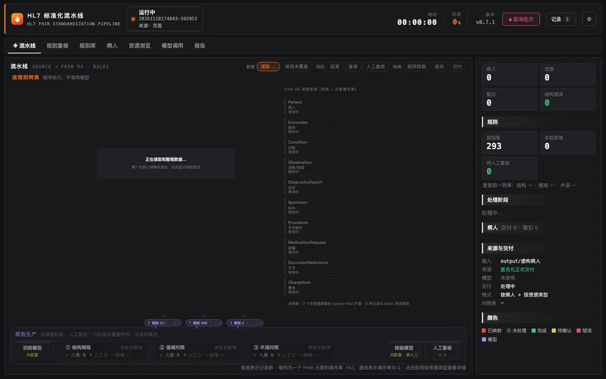
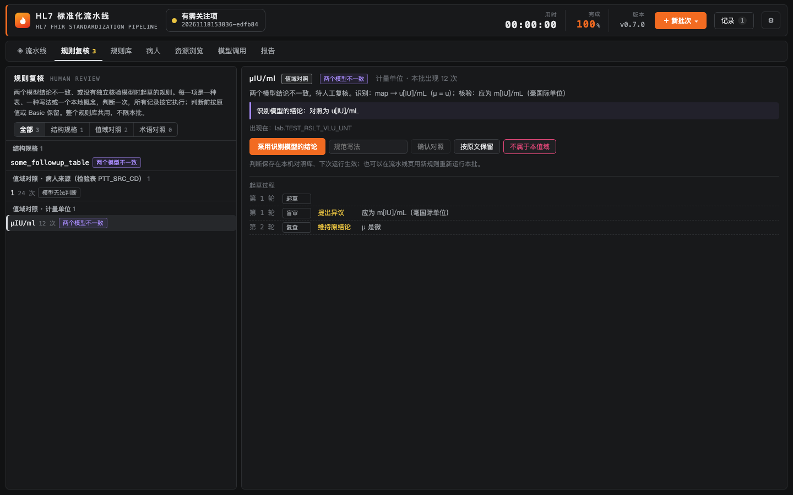
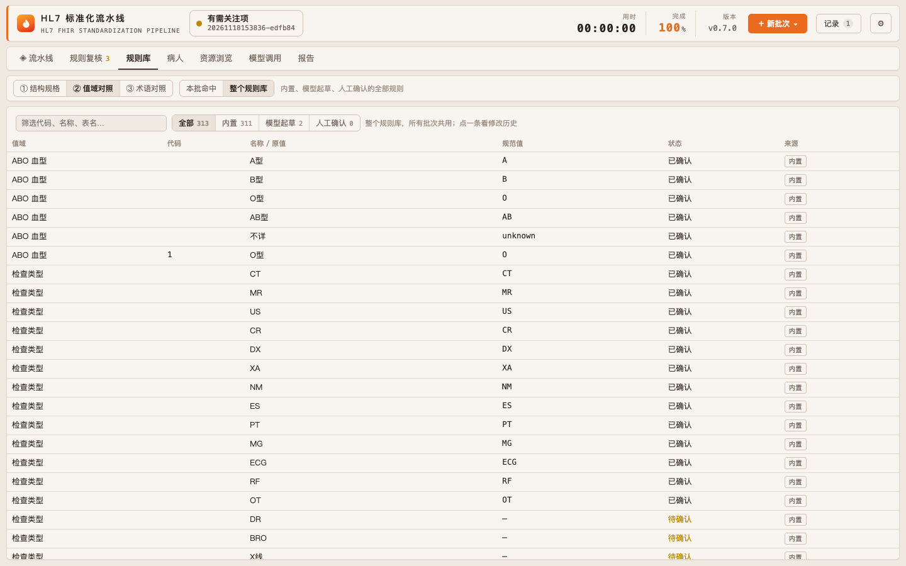

<div align="center">

# HL7 Standardization Pipeline · dsh-medical-hl7

**Standardize heterogeneous, messy medical data into HL7 FHIR R4: rules are drafted by two models and reviewed by people; conversion is done by code that follows the rules.**

[简体中文](https://github.com/wld007/dsh-medical-hl7/blob/main/README.md) · English

DeepSeek Harness plugin · schema harmonization · value normalization · terminology mapping · two-model cross-check + human review · records go only to your own model endpoint

[](https://www.npmjs.com/package/dsh-medical-hl7)




<sub>Recorded from a real run on fictional data (`scripts/demo-data.mjs`, 16 fictional patients, 10 tables without a mapping spec) against a local fake model endpoint: rule production at the bottom (drafting, blind review, recheck per table), then conversion by rules, rule review and the rule library. The two models disagree on a few items so that human review is visible. Re-record with `scripts/readme-demo.mjs`.</sub>

</div>

---

## What it does

```
Medical data de-identification → [HL7 standardization] → FHIR R4 (transaction Bundles, Bulk NDJSON, definitions) → FHIR servers, data exchange, research platforms…
```

- **One transaction Bundle per patient**: PUT with stable ids, importable (and re-importable) into any FHIR server; plus cohort **Bulk Data NDJSON** and `manifest.json`.
- **definitions/**: the extensions (StructureDefinition), local code systems (CodeSystem) and confirmed mappings (ConceptMap) used in the batch.
- **Values unchanged, nothing dropped**: times are only reformatted, codes go into local code systems as-is, unmapped fields are kept as `source-field` extensions, unknown tables become Basic.
- **Any field naming**: json, ndjson, csv; tables without a mapping spec get one drafted by the models.
- **Never modifies input**; record content is sent only to the model endpoint you configure.

## Rule-driven: models produce rules, code does the conversion

Unlike chart abstraction, where every document goes through a model, HL7 standardization only needs three kinds of **rules**, all finite:

| Rule | Unit | Example |
|---|---|---|
| ① Schema spec | one per table | this table holds lab results; `TEST_RSLT_VLU` is the value, `RPT_NO` the report number |
| ② Value mapping | one per spelling | `μIU/ml` → `u[IU]/mL`; sex `1` → `male` |
| ③ Terminology mapping | one per local concept | local test "creatinine (umol/L)" → LOINC `14682-9` |

Once the rules exist, every record is processed by code, so **the number of model calls does not grow with the data**. Tables, spellings and concepts that the rules do not cover are sent back to rule production.

## Two models + human review

```
uncovered item → suggest model drafts → plugin checks → verify model blind review ─ agree ─→ rule library ("model · unreviewed")
                                                              └ disagree → models recheck in turn (≤ 3 rounds) ─ agree ─→ rule library
                                                                                               └ still disagree → human review
```

- **Plugin checks come first**: fields must exist, roles must fit the record kind, time fields must parse, bound value sets must recognize the sample values, codes must be in the target value set, LOINC / SNOMED CT check digits must be valid.
- **Blind review**: the verify model sees only input + conclusion, not the suggest model's reasoning.
- **Terminology from candidates only**: candidates are retrieved from local code tables (LOINC, optionally its Chinese linguistic variant; SNOMED CT); a code is accepted only if both models pick it independently. In our tests about half of the LOINC codes models produce from memory do not exist, so standards without a local table are not sent to the models.
- **Key links decided by data**: the patient id is the identifier pseudonym that is constant within each patient's files; encounter links are chosen by whether a table's values can be found in the encounter registration table.
- **Without an independent verify model** the same model is never asked to review itself: drafts that pass the plugin checks all go to human review, and a schema spec takes effect only after a person confirms it.
- **Conversion does not wait for review**: unconfirmed items stay as original values or Basic; rerun the batch with the new rules afterwards.
- Model conclusions are tagged in FHIR (`meta.tag` / `mapping-origin` extension) until a person confirms them; every change is logged in the local rule library.

## Page

The sidebar entry "HL7 标准化" opens the pipeline page:

| Tab | Content |
|---|---|
| ◈ Pipeline | Top: conversion by rules — sources flow through gates ① ② ③ into 10 FHIR resource types (line width = records, column height = element fill rate); each gate shows its rule library (↑ rules N) and uncovered items (↓ N). Bottom: rule production — suggest model, verify model and human review, with live counts per step while rules are drafted |
| Rule review | Rules waiting for a person (whole library, not just this batch), sorted by occurrences, with each model's conclusion and reasoning per round; confirm, edit, reject, or decide a whole group at once |
| Rule library | Schema specs, value mappings, terminology mappings: "this batch" shows which rule each table, spelling and concept used; "whole library" lists built-in, model-drafted and human-confirmed rules with change history |
| Patients · Resources | Per-patient resources and checks; full FHIR JSON with document text decoded |
| Model calls · Report | Cross-check statistics per stage, recent calls (sizes, timings and tokens only); batch report |

<table><tr>
<td></td>
<td></td>
</tr></table>

## Install and configure

Requires DSH `>= 0.2.1` and Node.js `>= 20` (the record store uses built-in `node:sqlite`; below Node 22.13 it falls back to JSON files). Install `dsh-medical-hl7` from DeepSeek Harness plugin management, or:

```bash
dsh plugin --profile <profile> add dsh-medical-hl7
```

Then in Settings → "HL7 标准化":

- **Suggest model**: OpenAI-compatible `/v1` endpoint, model name, optional API key; use "测试连接" to check. Without a model, only built-in specs and existing rules are used; tables without a spec become Basic.
- **Verify model** (recommended): another endpoint + model for blind review. Without it, all drafts go to human review.
- **Local code tables** for terminology mapping: LOINC `Loinc.csv` (plus `LinguisticVariants/zhCN…LinguisticVariant.csv`), SNOMED CT `sct2_Description_Snapshot`.
- **Conversion**: namespace (do not change once chosen), default time zone, output format, residual identifier handling, official HL7 Validator path.

Only field names, fill rates, truncated value samples and local codes / names are sent to the models — never document text. Use local or intranet model servers for patient data.

## Usage

- **Page**: "＋ 新批次", pick a folder or file (usually the anonymizer's delivery folder).
- **Chat**: `/hl7 <input dir or file> [--out output root]`
- **Agent tools**: `hl7_start`, `hl7_status`, `hl7_report`, `hl7_runs`, `hl7_cancel`. Agents cannot choose endpoints, models or keys. Cancelled or failed batches continue with `resumeFrom`, reusing finished patients and model calls.

## Output

```text
<output root>/                     # default: _medical-hl7 next to the input
  <input name>/                    # delivery (appears when the batch finishes)
    bundles/<patient>.json
    ndjson/<resource type>.ndjson
    definitions/
    manifest.json
  _records/                        # records, not for downstream use
    records.sqlite                 # batches, stage statistics, specs used, model calls and cache
    runs/<batch>/report.md|json
    runs/<batch>/stages/           # intermediate records (gz)
    runs/<batch>/held/             # patients that failed checks
<plugin data>/vocab/vocab.sqlite   # local rule library shared by all batches, with change history
```

Details: [docs/pipeline.md](docs/pipeline.md), [docs/bundle-fields.md](docs/bundle-fields.md), [CHANGELOG.md](CHANGELOG.md) (Chinese).

## Development

```sh
npm test                              # tests (fictional data + mock models, no network)
node scripts/build.mjs 0.7.2-dev.1    # build dist/<version>, then install from the profile
REACT_UMD_DIR=<dir with react.js, react-dom.js> node scripts/preview-page.mjs <stateDir>   # preview the page outside DSH

# re-record the README animation (fictional data + local fake models, frames via local Chrome)
REACT_UMD_DIR=… node scripts/readme-demo.mjs /tmp/hl7-demo [patients]
python3 scripts/readme-demo.py /tmp/hl7-demo assets/demo.webp   # needs Pillow
```

## License

MIT, see [LICENSE](LICENSE).
