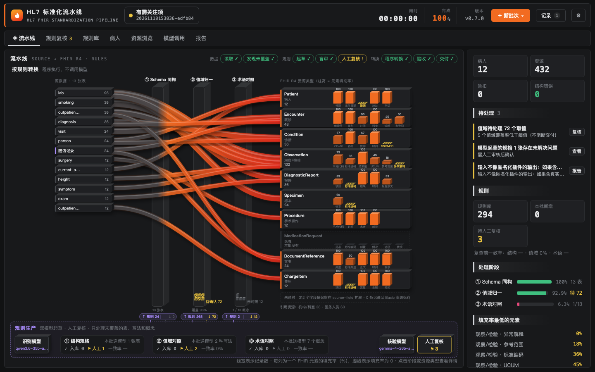
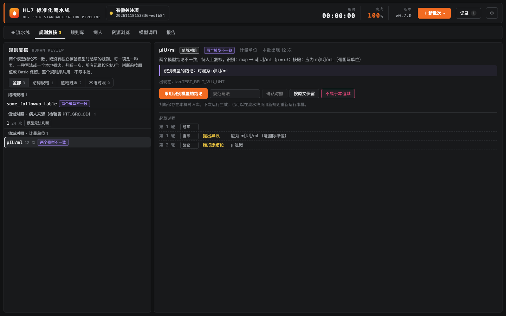
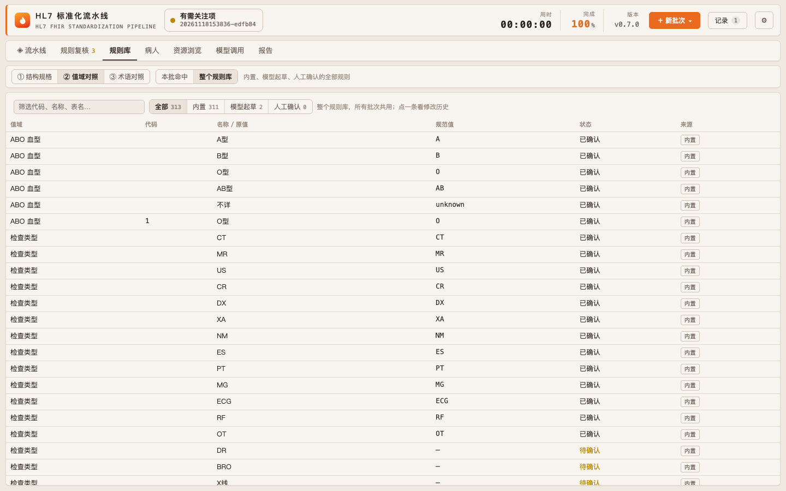

<div align="center">

# HL7 标准化流水线 · dsh-medical-hl7

**把来源各异、不规范的医疗数据标准化为 HL7 FHIR R4：规则由双模型起草、人工复核，转换由程序按规则执行。**

简体中文 · [English](https://github.com/wld007/dsh-medical-hl7/blob/main/README.en.md)

DeepSeek Harness 插件 · Schema 同构 · 值域归一 · 术语对照 · 双模型交叉核验 + 人工复核 · 病历只发往你自己的模型端点

[](https://www.npmjs.com/package/dsh-medical-hl7)




<sub>截图用虚构数据（`test/fixtures`，12 位虚构病人）和本机假模型端点运行得到；两个模型故意设成有分歧，以展示人工复核。</sub>

</div>

---

## 它做什么

```
医疗数据匿名化 → 【HL7 标准化】 → FHIR R4（transaction Bundle、Bulk NDJSON、definitions）→ FHIR 服务器、数据交换、科研平台……
```

- **每位病人一个 transaction Bundle**：PUT + 稳定编号，可以直接、重复导入任何 FHIR 服务器（HAPI 等）；另出整批 **Bulk Data NDJSON** 和 `manifest.json`。
- **附带 definitions/**：本批用到的扩展（StructureDefinition）、本地代码字典（CodeSystem）和已确认的对照（ConceptMap），接收方加载后就能识别本地内容。
- **取值不变、不丢数据**：时间只做格式转换，代码原样进本地代码体系，没对应的字段以 `source-field` 扩展保留，不认识的表以 Basic 保存。
- **字段命名不限**：json、ndjson、csv 都行；没有映射规格的表由模型起草。
- **绝不修改输入**；病历内容只发往你在设置里配置的模型端点。

## 规则驱动：模型只产生规则，程序执行转换

和逐份过模型的病历文书提取不同，HL7 标准化要定的只有三类**规则**，而且都是有限的：

| 规则 | 单位 | 例子 |
|---|---|---|
| ① 结构规格 | 一种表一份 | 这张表是检验结果；`TEST_RSLT_VLU` 是结果值、`RPT_NO` 是报告号 |
| ② 值域对照 | 一种写法一条 | `μIU/ml` → `u[IU]/mL`；性别 `1` → `male` |
| ③ 术语对照 | 一个本地概念一条 | 本地检验项目“肌酐（umol/L）” → LOINC `14682-9` |

规则定下来以后，所有记录都由程序按规则处理，**模型调用次数和记录数无关**：一千万条记录，只要表和写法还是这些，就不用再调模型。程序跑的时候遇到规则没覆盖到的表、写法、概念，再送回规则生产补规则。

## 双模型 + 人工复核

```
未覆盖项 → 识别模型起草 → 插件校验 → 核验模型盲审 ─ 一致 ─→ 入规则库（标“模型 · 未复核”，可抽查确认）
                                         └ 不一致 → 两个模型轮流复查（至多 3 轮，可设 1–6）─ 一致 ─→ 入规则库
                                                                            └ 仍不一致 → 人工复核 → 入规则库
```

- **插件校验先于模型**：字段要存在、角色要属于该类别、时间字段要能解析、绑定的值域要认得样本里的取值、代码要在目标值集里、LOINC / SNOMED CT 校验位要对。
- **独立盲审**：核验模型只看“输入 + 结论”，看不到识别模型的理由。
- **术语只在候选里选**：候选从本地代码表（LOINC，可加中文变体；SNOMED CT）检索，两个模型独立选出同一个代码才采用。实测模型直接给出的 LOINC 代码约半数不存在，所以没配代码表的标准不交给模型。
- **关键关联由数据决定**：病人编号取每位病人文件里恒定的证件假名字段；就诊号关联按各表取值能否在就诊登记表里找到来定，不信模型的选择。
- **没有独立的核验模型时**：不让同一个模型自己审自己，起草结果通过插件校验后一律转人工复核；结构规格在人工确认前不生效（这张表按 Basic 保存）。
- **人工复核期间转换不等**：没确认的项按原值或 Basic 保留，复核完后用新规则重新运行本批。
- 模型结论在 FHIR 里带标记（`meta.tag` / `mapping-origin` 扩展），人工确认后去除；每一次改动都记入本机对照库的修改历史。

## 页面

左侧栏「HL7 标准化」打开「HL7 标准化流水线」页面：

| 标签 | 内容 |
|---|---|
| ◈ 流水线 | 上层「按规则转换」：源数据经 ① ② ③ 三个关口映射到 10 个 FHIR 资源类型，线宽是记录数，柱高是各 FHIR 元素的填充率；每个关口底部是规则库（↑ 规则 N）和未覆盖数（↓ N）。底部「规则生产」：识别模型、核验模型、人工复核三个工位，起草规则时展开显示每段各站（待定 → 起草 → 校验 → 盲审 → 复查 → 入库 / 转人工）的实时数量 |
| 规则复核 | 待人工判断的规则（整个规则库，不限本批），按出现次数排序，附两个模型每一轮的结论和理由；可确认、改写、不采用，同组可一次判断 |
| 规则库 | 结构规格、值域对照、术语对照：「本批命中」看每张表、每种写法、每个概念用了哪条规则；「整个规则库」看内置、模型起草、人工确认的全部规则和修改历史 |
| 病人 · 资源浏览 | 每位病人的资源、验收结果；完整的 FHIR JSON，文书正文解码成可读文字 |
| 模型调用 · 报告 | 各阶段交叉核验统计、最近的调用（只记大小、耗时和 token）；批次报告 |

<table><tr>
<td></td>
<td></td>
</tr><tr><td align="center"><sub>规则复核：两个模型每一轮的结论</sub></td><td align="center"><sub>规则库：内置 / 模型起草 / 人工确认</sub></td></tr></table>

深色、浅色跟随 DSH 主题；主题色是 HL7 FHIR 官方的火焰橙红。

## 安装与配置

要求 DSH `>= 0.2.1`、Node.js `>= 20`（记录库用内置的 `node:sqlite`，Node 22.13 以下自动退回 JSON 文件）。在 DeepSeek Harness 的插件管理里安装 `dsh-medical-hl7`，或：

```bash
dsh plugin --profile <profile> add dsh-medical-hl7
```

然后在设置 →「HL7 标准化」里配置：

- **识别模型**：OpenAI 兼容的 `/v1` 端点、模型名、API Key（可选），用「测试连接」检查。不配模型时只按内置规格和已有规则转换，没有规格的表以 Basic 保存。
- **核验模型**（建议）：另一个端点 + 模型，做独立盲审。不配时，起草结果全部转人工复核。
- **本地代码表**（术语对照用）：LOINC `Loinc.csv`（建议加 `LinguisticVariants/zhCN…LinguisticVariant.csv`）、SNOMED CT `sct2_Description_Snapshot`。LOINC 在 loinc.org 免费注册后下载。
- **转换**：命名空间（确定后不要再改）、默认时区、交付格式、残留标识符的处理方式、官方 HL7 Validator 路径。

开发和测试中使用的组合：vLLM 部署的 `qwen3.6-35b-a3b`（识别）和 `gemma-4-26b-a4b-it`（核验）。发给模型的只有字段名、填充率、截短的取值样例和本地代码 / 名称，不发文书正文；处理患者数据请使用本机或机构内网的服务。

## 用法

- **页面**：点「＋ 新批次」选目录或文件（通常是匿名化插件的交付目录）。
- **聊天框**：`/hl7 <输入目录或文件> [--out 输出根目录]`
- **Agent 工具**：`hl7_start`、`hl7_status`、`hl7_report`、`hl7_runs`、`hl7_cancel`。Agent 不能指定端点、模型或 API Key。取消或失败的批次可用 `resumeFrom` 继续，已完成的病人和模型调用直接复用。

## 流水线与验收

| 环节 | 做什么 | 规则 / 验收 |
|---|---|---|
| 读取 | 找出数据文件，按病人目录分组；跳过 `_medical-*` 输出目录 | 运行前后核对源文件 |
| 发现未覆盖 | 找出没有规格的表、没有对照的写法和概念 | 送规则生产 |
| 规则生产 | 双模型起草 → 插件校验 → 盲审 → 复查 → 入库 / 人工复核 | 复查前一致率 |
| ① Schema 同构 | 表 → 记录类别，字段 → 语义角色；只做结构映射，不改取值 | 未映射字段以 source-field 保留 |
| ② 值域归一 | 同一含义的不同写法统一为规范值；含义未确认的标“待确认”，按原值交付 | 覆盖率低于阈值告警（不阻断） |
| ③ 术语对照 | 本地概念 → LOINC、SNOMED CT、国家标准代码表；另加标准编码，原代码不变 | 校验位、候选集 |
| ④ FHIR 组装 | 每类记录一个构建器，只认语义角色，由它负责 FHIR 正确性 | — |
| 验收 | 结构与引用完整性；残留身份证号 / 手机号扫描（附件正文解码后再扫） | 未通过的病人暂扣，不交付 |
| 交付 | Bundle、NDJSON、definitions、manifest；可选官方 HL7 Validator 离线抽检（`-tx n/a`） | — |

| 记录类别 | FHIR |
|---|---|
| patient / address / death | Patient（+ 问题列表 Condition、死因 Observation） |
| encounter | Encounter |
| condition | Condition（挂回 Encounter.diagnosis） |
| lab | Observation，按报告号归并成 DiagnosticReport，标本生成 Specimen |
| imaging | DiagnosticReport（结论 + 正文附件） |
| procedure | Procedure |
| document | DocumentReference（正文附件），文书里的结构化体征另出 Observation |
| observation | Observation（体征用 LOINC + UCUM，血压合成 85354-9 面板） |
| medication · charge · generic | MedicationRequest · ChargeItem · Basic |

字段说明见 [docs/bundle-fields.md](docs/bundle-fields.md)，流程细节、内置值域和已知待确认项见 [docs/pipeline.md](docs/pipeline.md)。

## 交付

```text
<输出根目录>/                       # 默认：输入旁边的 _medical-hl7
  <输入名>/                        # 交付（批次结束后才出现；未通过验收的病人不在里面）
    bundles/<病人>.json             # 每位病人一个 transaction Bundle
    ndjson/<资源类型>.ndjson         # 整批 Bulk Data
    definitions/                    # StructureDefinition、CodeSystem、ConceptMap
    manifest.json
  _records/                        # 记录：不要交给下游
    records.sqlite                 # 批次、阶段统计、本批实际使用的映射规格、模型调用与缓存（0600）
    runs/<批次>/report.md|json      # 报告
    runs/<批次>/stages/             # 中间结果：同构记录、归一记录（gz）
    runs/<批次>/held/               # 未通过验收的病人
<插件数据目录>/vocab/vocab.sqlite    # 本机规则库：人工复核与模型结果，所有批次共用，含修改历史（0600）
```

## 转换口径

- **取值不变**：时间只做格式转换（毫秒 / 秒时间戳、`YYYYMMDD` 等都识别；没写时区的按设置处理，默认 +08:00）；文本只去首尾空白；文书正文原样放进附件。
- **代码原样**：本地代码进本地代码体系（机构自编的代码按机构区分），只对含义已确认的代码加标准编码；含义不明的代码不换算，原值放在扩展里。
- **不编造**：被其他记录引用、但就诊登记里没有的就诊，按号码生成 Encounter（`status=unknown`，带 `encounter-not-registered` 标签，不填时间）。
- **编号稳定**：资源 id 由来源表 + 源记录主键派生，重跑不变。
- **一码多名**：同一本地代码出现过的不同名称全部登记为同义名，报告里列出作为数据质量提示。

## 原则

沿用 dsh-medical 插件家族的约定：绝不修改输入；病历内容只发往设置里的模型端点，Agent 不能选择端点；模型结论都经插件校验，关键关联由数据决定；不做推测，含义未确认的按原值保留；编号稳定；规则、交接格式带版本。

## 开发

```sh
npm test                              # 测试（虚构数据 + 模拟模型，不需要网络）
node scripts/build.mjs 0.7.1-dev.1    # 生成 dist/<版本>，再从 profile 安装
```

测试只使用虚构数据；真实病历和由病历派生的结果都不进仓库。更新记录见 [CHANGELOG.md](CHANGELOG.md)。

## 许可

MIT，见 [LICENSE](LICENSE)。
